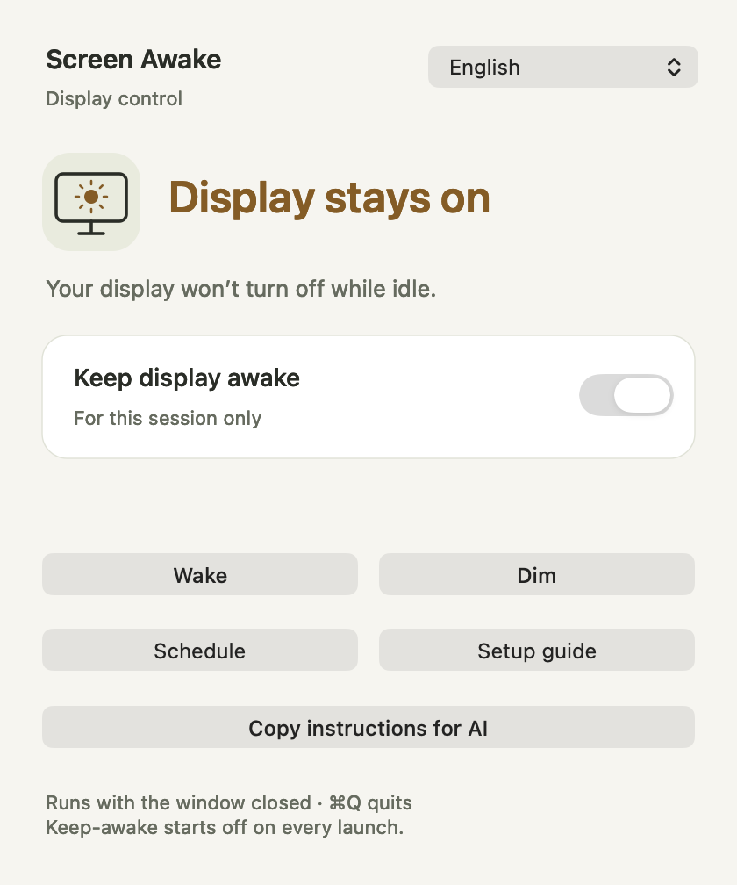
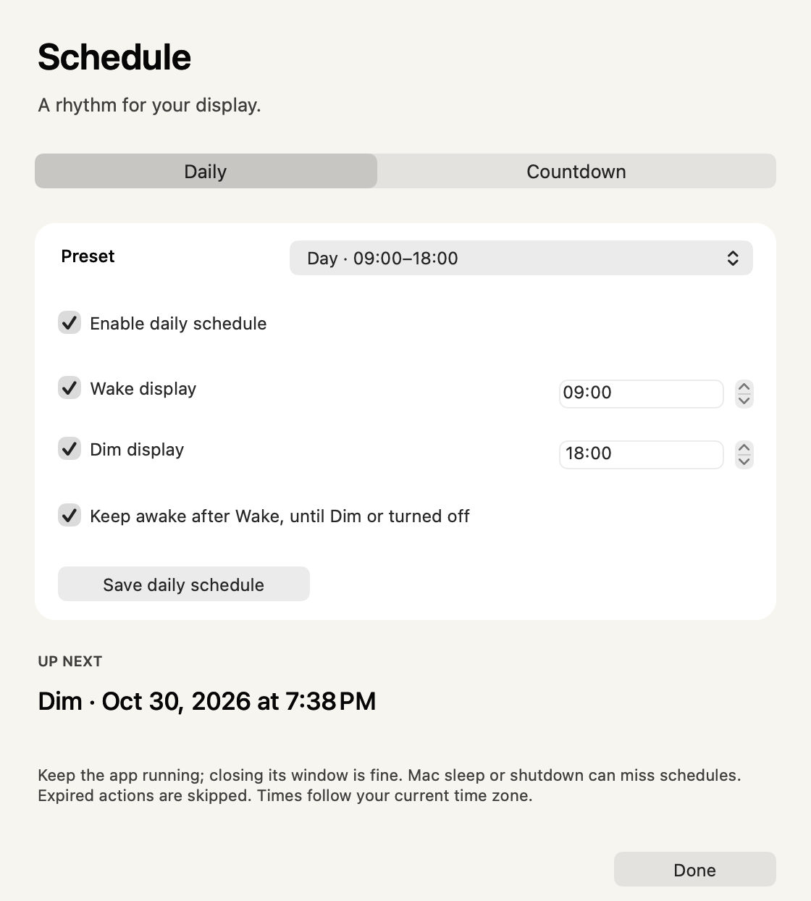

# Screen Awake

Keep your Mac’s display on with one switch. Wake or turn off the display from a small native window or the menu bar, with daily schedules and countdowns.

[Download for macOS](https://github.com/mickyyang-1407/screen-awake/releases/latest/download/Screen-Awake-universal.dmg) · [ZIP](https://github.com/mickyyang-1407/screen-awake/releases/latest/download/Screen-Awake-universal.zip) · [繁體中文](README.zh-Hant.md)

macOS 14 or later · Apple silicon and Intel · English and 繁體中文 · MIT



## Start here

1. [Download the DMG](https://github.com/mickyyang-1407/screen-awake/releases/latest/download/Screen-Awake-universal.dmg) and drag **Screen Awake** into **Applications**.
2. Open the app and click **Copy instructions for AI**.
3. Paste into Claude Code or another AI with local command access. Then just ask: **“Keep my screen on”**, **“Dim in 30 minutes”**, or **“Wake at 9 AM and Dim at 6 PM every day.”**

The copied text includes this installation's exact path. The AI reads the built-in guide and controls wake, keep-awake and schedules through commands; it needs no GUI automation. Signed and Apple notarized. No account, plug-in or developer setup.

You can also use all controls yourself. The language menu switches English and Traditional Chinese.

| Control | What it does |
| --- | --- |
| Keep display awake — ON | Keeps the display on while the app runs. |
| Keep display awake — OFF | Returns to the existing system idle timeout. |
| Wake | Wakes the display once; it does not enable continuous keep-awake. |
| Dim | Releases this app’s keep-awake request, then asks macOS to turn off the display. |

**Keep-awake starts off on every launch.** Your language choice is remembered. While an action runs, display controls are disabled briefly; progress and errors appear in the main window.

## Use it from the menu bar

Look for the **monitor icon**. A sun inside the monitor means keep-awake is on. Click it for the switch, Wake, Dim, the main window, Schedule, Setup guide or Quit.

Closing the window leaves the app running. The menu bar or Dock icon reopens it; **⌘Q** quits and releases this app’s keep-awake request. Other apps may have their own requests.

## Schedule your display

Open **Schedule** in the main window or menu bar.

- **Daily:** choose Early (08:00–17:00), Day (09:00–18:00), Night (20:00–08:00), or set your own times. Check **Enable daily schedule**, choose Wake and/or Dim, then click **Save daily schedule**. Presets fill the fields; they do not activate anything until saved.
- **Keep awake after Wake** holds the display on until a Dim action or you turn keep-awake off. Uncheck it for a one-time wake.
- **Countdown:** choose 15, 30, 60 or 120 minutes, or type a whole number from 1 to 1440. Choose Wake or Dim and click **Start countdown**. Restart replaces the existing countdown; Cancel removes it.

Daily and countdown schedules can run together. The panel and menu bar show the next action. Dim wins if two actions have the exact same time. A countdown Wake is a one-time wake.

**Keep the app running.** Closing a window is fine; quitting stops execution. Saved daily schedules and future countdowns resume when you reopen the app. A new installation has no enabled schedules, and saving one does not immediately change your display.

Times follow the current Mac time zone. The app does not wake a sleeping or powered-off Mac. On launch, system wake or clock changes it recalculates future events and skips expired actions. A running timer allows up to 30 seconds for ordinary delivery delays or a busy display control, then skips the action. Daily actions run at most once per local calendar day. For daylight saving changes, a missing time moves to the next valid time and a repeated hour runs once.



## Optional: wake without a password

The keep-awake switch works with your current password settings. If you want to turn off the display and return without authentication, follow the [setup guide](SETUP.md). It covers the Lock Screen setting, the greyed-out option caused by iPhone Mirroring, a manual check, and restoring protection afterwards.

The app’s **Setup guide** button also explains the settings and opens the relevant System Settings pane. Security settings are changed by you. Wake cannot unlock an already locked Mac; an explicit lock by you or another app still requires unlocking.

## Use it with an AI assistant

Click **Copy instructions for AI** in the app or menu bar and paste the result into your assistant. It runs a read-only `agent-help` command from the installed app, so the instructions work offline and include the correct local path.

Your AI can wake the screen, turn continuous keep-awake on/off, set daily times, start a countdown and read the saved result. New schedules start the app in the background if needed. [AI command reference](AI-USAGE.md).

An AI needs permission to run commands on this Mac. Wake cannot unlock a locked session or wake a sleeping/powered-off computer. The optional password setup stays under your control.

## For recording scripts

The downloaded app already includes a CLI. With the app in Applications:

```sh
AWAKE='/Applications/Screen Awake.app/Contents/MacOS/ScreenAwake'
"$AWAKE" status
"$AWAKE" wake
# Run your recording command here and wait for completion.
"$AWAKE" dim
```

`wake` checks the display-off password requirement and waits for its two-second user-activity assertion to end. It leaves no continuous keep-awake process. The normal display timeout still applies during recording; for a longer recording, use `awake on` before recording. `dim` releases the running app’s keep-awake request before sleeping the display.

`dim` requests display sleep. Exit 0 means the request was accepted; input or another app may wake the display again. Failures return nonzero, including when macOS prints a rejection but returns 0 itself. `--help` lists the commands; `--version` prints the version. These commands do not change system timeouts or security settings and require no sudo.

## A small native app

- Swift and AppKit, with no third-party runtime or dependencies.
- macOS power management API, with no simulated mouse movement or repeated disk scanning.
- No accounts, analytics or app-originated network requests. Documents and media are not scanned; preferences stay on your Mac.

## Build from source

For development, use Xcode with Swift 6.2 or later:

```sh
git clone https://github.com/mickyyang-1407/screen-awake.git
cd screen-awake
zsh scripts/build.sh
open "build/Screen Awake.app"
```

The native SDK build produces a universal app with a local ad-hoc signature. No signing certificate is needed and no dependencies are downloaded. `zsh scripts/build.sh --cli-only` produces `build/ScreenAwake` without packaging the GUI bundle.

Run `zsh scripts/check.sh` for isolated CLI, schedule and AI-control checks (private preferences, local timer callbacks, no live display or settings changes), and `zsh scripts/render-previews.sh` for bilingual state, schedule and guide previews.

Bug reports and focused improvements are welcome. Please include your macOS version, chosen language and expected behavior when opening an issue.

[MIT license](LICENSE). Made by [Micky Yang](https://github.com/mickyyang-1407).
