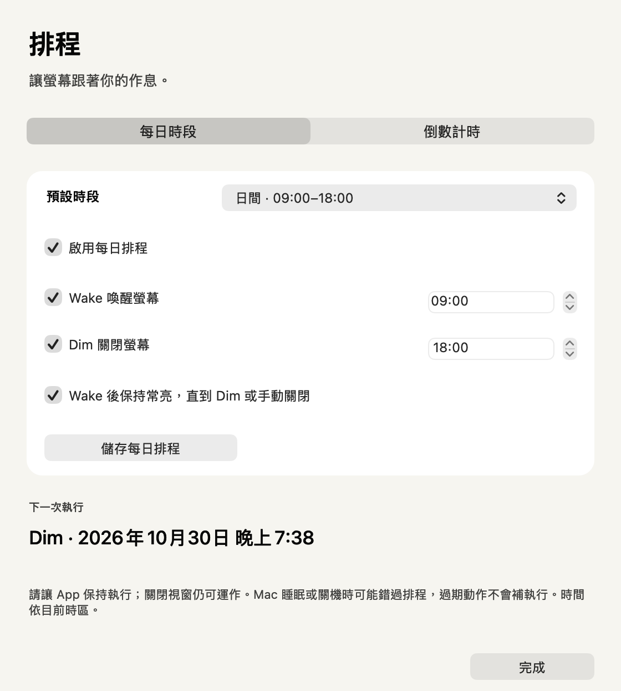

# Screen Awake 螢幕常亮

用一個開關讓 Mac 螢幕保持開啟。也能從小視窗或選單列，直接喚醒、關閉螢幕，並設定每天時段或倒數。

[下載 macOS 版](https://github.com/mickyyang-1407/screen-awake/releases/latest/download/Screen-Awake-universal.dmg) · [ZIP 下載](https://github.com/mickyyang-1407/screen-awake/releases/latest/download/Screen-Awake-universal.zip) · [English](README.md)

macOS 14 以上 · Apple silicon 與 Intel · 繁體中文與英文 · MIT 授權


## 下載後直接使用

1. 下載 DMG，把 **Screen Awake** 拖進 **Applications**；也可以下載 ZIP 並解壓縮。
2. 開啟 **Screen Awake**。下載版已完成 Developer ID 簽署與 Apple 公證。
3. 使用常亮開關，或點 **Wake 喚醒螢幕**、**Dim 關閉螢幕**。語言選單可切換繁中與英文。

| 控制項 | 用途 |
| --- | --- |
| 保持螢幕開啟 — ON | App 運作期間，螢幕不會因閒置而關閉。 |
| 保持螢幕開啟 — OFF | 恢復系統原本的螢幕閒置時間。 |
| Wake 喚醒螢幕 | 喚醒一次，不會自動打開持續常亮。 |
| Dim 關閉螢幕 | 先釋放本 App 的常亮要求，再請系統關閉螢幕。 |

**每次啟動都預設關閉常亮**，語言選擇會記住。執行操作時，顯示器控制會短暫停用；主視窗會顯示進度或錯誤。

## 從選單列操作

找到**螢幕圖示**；裡面有太陽代表常亮已開啟。點它可切換常亮、執行 Wake／Dim、顯示主視窗、開啟排程、設定教學或結束 App。

關閉視窗後，App 仍會運作。選單列或 Dock 圖示可重新開啟視窗；按 **⌘Q** 結束 App，便會釋放自己的常亮要求。其他 App 仍可能有各自的要求。

## 設定排程

從主視窗或選單列開啟 **排程**。

- **每日時段**：選早班（08:00–17:00）、日間（09:00–18:00）、夜間（20:00–08:00），或自行輸入時間。勾選 **啟用每日排程**，選擇 Wake／Dim 動作，再按 **儲存每日排程**。選 Preset 只會填入欄位，儲存後才生效。
- **Wake 後保持常亮**：直到 Dim 或你手動關閉常亮為止。取消勾選則只喚醒一次。
- **倒數計時**：選 15、30、60、120 分鐘，或自行輸入 1–1440 的整數分鐘。選 Wake 或 Dim，再按 **開始倒數**。重新開始會取代原本的倒數，也能隨時取消。

每日排程與倒數可同時使用，排程頁與選單列會顯示下一次執行的動作。同一時間發生衝突時，優先執行 Dim。倒數 Wake 只喚醒一次。

**請讓 App 保持執行。** 關閉視窗仍可運作，結束 App 就不會執行。重開後會恢復已儲存的每日排程與尚未到期的倒數。新安裝預設沒有啟用排程；儲存排程不會立刻改變螢幕狀態。

時間依 Mac 目前時區。App 無法喚醒睡眠或關機中的 Mac；啟動、系統喚醒或時鐘變更時，會重新計算未來事件，略過過期動作。App 執行中的計時器容許一般延遲或顯示器控制忙碌最多 30 秒，超過便略過。每日動作在同一個當地日期最多執行一次；夏令時間跳過的時間會順延至下一個有效時間，重複的小時只執行一次。



## 選用：喚醒後不要求密碼

只使用常亮開關，可以保留目前的密碼設定。如果希望關閉螢幕後能直接回桌面，請看[完整設定教學](SETUP.zh-Hant.md)。教學包含 Lock Screen 設定、iPhone 鏡像輸出造成選項變灰色的處理方式、手動驗收與恢復保護的步驟。

App 裡的 **設定教學** 也能說明操作並打開對應的系統設定頁；安全設定由你親自變更。Wake 無法解鎖已鎖定的 Mac，你或其他程式送出的「立即鎖定」仍需要自行解鎖。

## 讓 AI 使用

有本機指令權限的 AI，可以在需要畫面的工作前呼叫螢幕常亮。[AI 使用說明與可複製範本](AI-USAGE.zh-Hant.md)包含安裝路徑、指令與限制。你可以直接貼給 AI，也能填好實際路徑後，加入該專案既有的 AI 工作指引。

GitHub 連結不會自動替 AI 完成設定。Mac 仍在運作時可以喚醒顯示器；已鎖定仍需親自解鎖，整台電腦睡眠或關機則無法用這個指令喚醒。

## 錄影腳本用法

下載的 App 已包含 CLI。App 放在 Applications 時可使用：

```sh
AWAKE='/Applications/Screen Awake.app/Contents/MacOS/ScreenAwake'
"$AWAKE" status
"$AWAKE" wake
# 在此執行錄影，並等待錄影完成。
"$AWAKE" dim
```

`wake` 會先讀取關屏後的密碼要求，等待兩秒的喚醒要求結束，不留下持續常亮程序。錄影期間仍遵循原本的閒置時間；較長的錄影可先手動打開 GUI 常亮，錄完關閉後再呼叫 CLI `dim`。

`dim` 請求關閉顯示器。回傳 0 表示請求被接受，使用者輸入或其他 App 仍可能再次喚醒螢幕；失敗會回傳非零，包含系統印出拒絕訊息但自身回傳 0 的情況。`--help` 列出指令，`--version` 顯示版本。CLI 不會修改系統閒置時間或安全設定，也不需要 sudo。

## 保持簡單

- 使用 Swift 與 AppKit，沒有第三方執行環境或相依套件。
- 使用 macOS 電源管理 API，不模擬滑鼠移動，也不反覆掃描磁碟。
- 沒有帳號、分析追蹤或 App 主動發出的網路請求，不掃描文件或媒體；偏好設定留在自己的 Mac。

## 從原始碼建置

開發者可使用含 Swift 6.2 以上版本的 Xcode：

```sh
git clone https://github.com/mickyyang-1407/screen-awake.git
cd screen-awake
zsh scripts/build.sh
open "build/Screen Awake.app"
```

建置使用 macOS 原生 SDK，產生 Apple silicon／Intel 通用版 App。本機建置採 ad-hoc 簽章，不需要憑證，也不會下載相依套件。`zsh scripts/build.sh --cli-only` 可略過 GUI 封裝，產生 `build/ScreenAwake`。

執行 `zsh scripts/check.sh` 可進行隔離 CLI 與排程檢查，使用獨立偏好設定與計時器回呼，不會真的關閉顯示器或改系統設定；`zsh scripts/render-previews.sh` 會產生雙語狀態、排程與教學畫面的預覽。

歡迎回報問題或提供範圍明確的改善。請附上 macOS 版本、介面語言及預期行為。

[MIT 授權](LICENSE)。由 [Micky Yang](https://github.com/mickyyang-1407) 製作。
