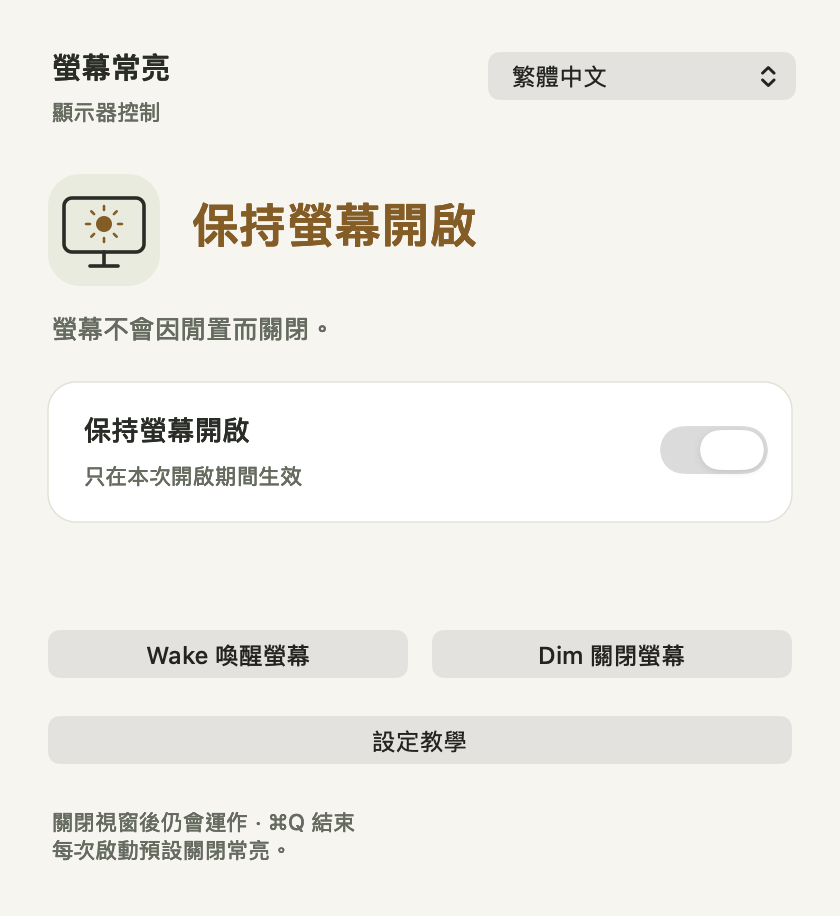

# Screen Awake 螢幕常亮

用一個開關讓 Mac 螢幕保持開啟。也提供錄影腳本用的 CLI，並內建設定教學。

[下載 macOS 版](https://github.com/mickyyang-1407/screen-awake/releases/latest/download/Screen-Awake-universal.dmg) · [ZIP 下載](https://github.com/mickyyang-1407/screen-awake/releases/latest/download/Screen-Awake-universal.zip) · [English](README.md)

macOS 14 以上 · Apple silicon 與 Intel · 繁體中文與英文 · MIT 授權



## 使用方式

### CLI：喚醒 → 錄影 → 暗掉

先用 `zsh scripts/build.sh --cli-only` 建置目前原始碼，再由 agent 的 shell 直接呼叫執行檔，不會開啟 GUI。此模式沿用同一份 Swift 原始碼，略過 GUI 圖示與 App 封裝：

```sh
./build/ScreenAwake status
./build/ScreenAwake wake
# 在這裡執行錄影指令，並等待錄影結束。
./build/ScreenAwake dim
```

`wake` 每次都會執行 `/usr/sbin/sysadminctl -screenLock status` 並輸出前置檢查結果，再執行 `/usr/bin/caffeinate -u -t 2`，等待兩秒的 assertion 結束；成功回傳 exit code 0。`dim` 以 `pmset displaysleepnow` 請求關閉顯示器；若 macOS 回報錯誤 1004，會嘗試 `IORequestIdle` 相容路徑。請求被接受時回傳 0，這不保證實體顯示器會維持關閉；指令失敗回傳非零，即使 `pmset` 印出休眠失敗但自身回傳 0，也會正確回報失敗。`--help` 顯示用法。錄影腳本可能失敗時，可用 shell `trap` 在離開腳本時呼叫 `dim`。

[閱讀完整設定教學](SETUP.zh-Hant.md)，包含 iPhone 鏡像輸出導致密碼選項變灰色的處理方式。App 內也能直接開啟教學。

**前置條件：**開始前 session 必須已解鎖。若要在螢幕暗掉後仍保持解鎖，請自行到 **System Settings > Lock Screen >「Require password after screen saver begins or display is turned off」**設為 **Never**。若無法確認是 Never（包含狀態讀取失敗），`wake` 只會警告並繼續，不會修改設定，也無法解開已經鎖定的 session。

CLI 不讀取、也不修改 `pmset displaysleep` 閒置時間或其他系統設定，不需要 `sudo`，不留下持續常亮的 assertion。錄影期間仍受原本的顯示器閒置時間限制，單次錄影請控制在該時間內。App 下載版內也包含相同 CLI：`Screen Awake.app/Contents/MacOS/ScreenAwake`。

### GUI

下載 DMG，把 **Screen Awake** 拖進 **Applications** 後開啟。也可以解壓縮 ZIP，直接開啟 App。

手動啟用「保持螢幕開啟」，離開鍵盤後螢幕仍會維持開啟。**每次啟動都預設關閉**，即使舊版本曾儲存為開啟，也不會自動恢復常亮。關掉開關，便會依系統的閒置時間設定休眠。

App 運作時，選單列會顯示**螢幕圖示**；裡面有太陽代表常亮已開啟。點它即可切換常亮、顯示視窗、開啟設定教學或結束 App。

關閉小視窗後仍會繼續運作。點選選單列或 Dock 圖示可重新開啟；按 **⌘Q** 結束 App，便會釋放它的亮屏要求。語言選擇會記住，常亮開關不會在下次啟動時恢復。

點 **設定教學** 可以閱讀步驟，並打開對應的系統設定頁。App 不會代改安全設定。

首次開啟會跟隨系統語言，也能透過語言選單切換繁體中文或英文，立即生效。

其他 App 也可能讓螢幕保持開啟。本工具只會釋放自己的要求；手動睡眠、鎖定、闔上筆電與 macOS 電源保護仍由系統控制。

## 保持簡單

- 使用 Swift 與 AppKit，沒有第三方執行環境或相依套件。
- 直接使用 macOS 電源管理 API，不模擬滑鼠移動，也不反覆掃描磁碟。
- 沒有帳號、分析追蹤或網路請求，不讀取文件或媒體；偏好設定留在自己的 Mac。

## 從原始碼建置

安裝含 Swift 6.2 以上版本的 Xcode 後執行：

```sh
git clone https://github.com/mickyyang-1407/screen-awake.git
cd screen-awake
zsh scripts/build.sh
open "build/Screen Awake.app"
```

建置使用 macOS 原生 SDK，產生同時支援 Apple silicon 與 Intel 的 App。本機建置採 ad-hoc 簽章，不需要憑證，也不會下載相依套件。

執行 `zsh scripts/check.sh` 可進行隔離 CLI 檢查，不會真的關閉顯示器或改系統設定；`zsh scripts/render-previews.sh` 會產生雙語、深淺色、錯誤狀態與教學畫面的預覽。

歡迎回報問題或提供範圍明確的改善。請附上 macOS 版本、介面語言及預期行為。

[MIT 授權](LICENSE)。由 [Micky Yang](https://github.com/mickyyang-1407) 製作。
